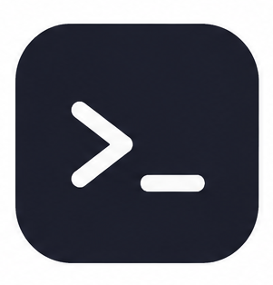
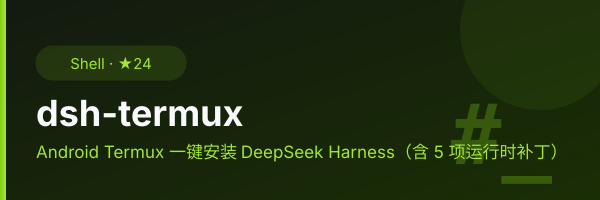

<p align="center">
  
</p>

<div align="center">
  
</div>

# dsh-termux

**English** · [中文](#中文) · [Русский](#русский)

One-command installer for [DeepSeek's `@deepseek-ai/dsh`](https://www.npmjs.com/package/@deepseek-ai/dsh) CLI on **Termux (Android)**, including the runtime patches needed to actually run it.

## Why this exists

`npm install -g @deepseek-ai/dsh` installs but does not run on Termux. Seven
independent incompatibilities have to be fixed:

| # | Package / feature | Problem | Fix |
|---|---|---|---|
| 1 | `node-pty` | node-gyp copies `process.config.variables.OS = "android"` into `config.gypi`, making gyp reference the undefined `android_ndk_path`. | Patch node-gyp to drop the `OS` variable so gyp infers `linux`. |
| 2 | `koffi` | `base.cc` calls `statx()`, hidden by bionic below API 30; clang targets `android24`. | Compile with `--target=aarch64-unknown-linux-android30`. |
| 3 | `sharp` | No prebuilt binding for `android-arm64`. | Install system `libvips` and build sharp against it. |
| 4 | HMR service | `cordis-plugin-hmr` needs Node `--expose-internals`; `node-addon-require-builtin` has no android prebuild. | Rewrite the `dsh` shebang to `node --expose-internals`. |
| 5 | `session-persistence-jsonl` | Publishes logs with a hard `link()`, forbidden on Android (`EACCES`). | Switch the atomic publish to `rename()`. |
| 6 | `attachment-local` | Fsyncs every ancestor directory up to `/` for crash durability, but the `untrusted_app` SELinux domain cannot `open("/data/data")`; publishing also uses `link()`. | Tolerate unopenable ancestors and fall back to `rename()`. Without this, `read_image` cannot store an image. |
| 7 | `fs-local` | The `write`/`edit` tools publish a **new** file with `link()` (no-replace semantics), which Android also refuses (`EACCES`). | Fall back to `rename()`; the guard still refuses to overwrite an existing file. Without this, every create-file write fails. |

## Install

```bash
pkg install -y git
git clone https://github.com/lilyco-42/dsh-termux.git
cd dsh-termux
bash install.sh
```

Or a single command:

```bash
bash <(curl -fsSL https://raw.githubusercontent.com/lilyco-42/dsh-termux/main/install.sh)
```

## Verify

```bash
dsh --version
dsh web            # serves the browser UI
dsh --profile headless "hello"   # one task, prints result, exits
```

You need a DeepSeek API key (`export DEEPSEEK_API_KEY=...`, or set it in the
web UI's Models page).

## Requirements

- Termux (the script installs everything else via `pkg`).
- Android 11 (API 30) or newer — required at runtime because `koffi` is built
  against API 30 (`statx`).

## What the script does

1. Installs `nodejs`, `build-essential`, `clang`, `cmake`, `ninja`, `python`, `libvips`.
2. Patches node-gyp's `create-config-gypi.js` (idempotent).
3. Installs `@deepseek-ai/dsh` globally with `CFLAGS`/`CXXFLAGS` targeting `android30`.
4. Builds `sharp` against the system `libvips`.
5. Patches `session-persistence-jsonl` to use `rename()` instead of `link()`.
6. Patches `attachment-local` (ancestor-fsync tolerance + `link()` fallback).
7. Patches `fs-local` so new files are published without `link()`.
8. Rewrites the `dsh` shebang to `node --expose-internals`.
9. Prompts you to paste your `DEEPSEEK_API_KEY` (input hidden), saves it to
   `~/.bashrc`, and exports it for the current shell. If you press Enter with
   nothing, it falls back to scanning for an existing key (env, dsh's
   credentials store, shell rc files).

All post-install patches are idempotent, so re-running `install.sh` is safe.

To set the key non-interactively (e.g. when piping the script), pass it in the
environment; interactively, the script just asks you to paste it:

```bash
DEEPSEEK_API_KEY=sk-... bash install.sh
```

---

## Fixes since 2026-11-25

Three problems above still break the run. The fixes below were made from 2026-11-25 onward; everything above is left as it was.

### Why the upstream fix falls short

`@deepseek-ai/dsh` (`0.2.2-rc.5` and `0.2.3-alpha.2`) depends on `node-addon-require-builtin@0.1.x`, which on Android/arm64 has no prebuilt `require_builtin.node` (its optionalDependencies cover only darwin, linux and win32) and whose JS fallback, `node-addon-native-custom-loader`, still calls `require()` on that missing binary. `dsh web` therefore dies at startup with:

```
Cannot find module '.../node-addon-require-builtin/build/napi/napi-v9-android-arm64/require_builtin.node'
```

Rewriting the shebang to `node --expose-internals` (what upstream does in step 8) does not help: the failure happens when the native binding is loaded.

The launcher already forces `--expose-internals`, and under that flag `require('internal/...')` resolves Node's internals directly. dsh needs five of them:

```
internal/modules/esm/loader
internal/modules/cjs/loader
internal/modules/helpers
internal/modules/esm/utils
internal/modules/esm/resolve
```

So `node-addon-require-builtin/lib/index.js` becomes a shim where `requireBuiltin(id)` calls `require(id)`. No cross-compilation involved.

### What changed since then

**1. require-builtin shim.** Pure-JS replacement of `lib/index.js`, marked `js-fallback`, backed up as `*.orig.bak`.

**2. flock fallback.** Session persistence locks the session file through `@deepseek-ai/node-addon-system`, which has no android build either; `flock.js` throws `ERR_FLOCK_UNSUPPORTED_PLATFORM` off linux/darwin. The fallback uses a lock file plus a pid liveness check and still raises `EAGAIN` when another process owns the session, so the "already owned" path keeps working. Checked with two processes: the first locks, the second is rejected.

**3. rename import.** The link-to-rename patch replaces the call but not always the import (some versions also import `lstat`, so the line stops matching), which shows up as `rename is not defined`. The installer now checks the import lists in `dsh-session-persistence-jsonl`, `dsh-attachment-local` and `dsh-fs-local` and adds `rename` where missing.

All patches are idempotent and reapplied after re-running `install.sh` or reinstalling the package.

### Tested on

REDMI K100 Pro Max (M098FE), Android 17 / HyperOS OS4.0.5.0.XGNCNXM, kernel 6.12.69-android16, aarch64, Termux from F-Droid, Node v26.13.1 (ABI 147), clang 21.1.8, Magisk Alpha 31100. Root is not required.

### Updated by

过氧亚硝基阴离子 (ONOO)

[GitHub](https://github.com/bluesrain) · [dsh-termux](https://github.com/bluesrain/dsh-termux)

---

## 中文

[English](#dsh-termux) · **中文** · [Русский](#русский)

在Termux（Android）上一键安装[DeepSeek的`@deepseek-ai/dsh`](https://www.npmjs.com/package/@deepseek-ai/dsh)CLI，并带上让它真正跑起来所需的运行时补丁。

### 为什么需要这个

`npm install -g @deepseek-ai/dsh`能装上，但在Termux里跑不起来。有七处互不相干的兼容问题要处理：

| # | 包／功能 | 问题 | 修法 |
|---|---|---|---|
| 1 | `node-pty` | node-gyp把`process.config.variables.OS = "android"`抄进config.gypi，让gyp去引用未定义的`android_ndk_path` | 改node-gyp，丢掉`OS`变量，让gyp自己推断成linux |
| 2 | `koffi` | `base.cc`调用`statx()`，bionic在API30以下隐藏了这个符号；而clang的target是`android24` | 用`--target=aarch64-unknown-linux-android30`编译 |
| 3 | `sharp` | android-arm64没有预编译绑定 | 装系统`libvips`，对着它编译sharp |
| 4 | HMR服务 | `cordis-plugin-hmr`需要Node的`--expose-internals`；`node-addon-require-builtin`没有android预编译 | 把`dsh`的shebang改成`node --expose-internals` |
| 5 | `session-persistence-jsonl` | 发布日志用硬链接`link()`，Android禁止（`EACCES`） | 原子发布改成`rename()` |
| 6 | `attachment-local` | 为崩溃一致性逐级fsync到`/`，但`untrusted_app`域打不开`/data/data`；发布也用`link()` | 容忍打不开的父目录，发布退回`rename()`。缺这步`read_image`存不了图 |
| 7 | `fs-local` | `write`/`edit`用`link()`发布**新**文件（不覆盖语义），Android同样拒绝（`EACCES`） | 退回`rename()`，外层判断依旧拒绝覆盖已有文件。缺这步所有新建文件的写入都失败 |

### 安装

```bash
pkg install -y git
git clone https://github.com/lilyco-42/dsh-termux.git
cd dsh-termux
bash install.sh
```

或者一条命令：

```bash
bash <(curl -fsSL https://raw.githubusercontent.com/lilyco-42/dsh-termux/main/install.sh)
```

### 验证

```bash
dsh --version
dsh web            # 起浏览器界面
dsh --profile headless "hello"   # 跑一个任务，打印结果后退出
```

需要一个DeepSeek API Key（`export DEEPSEEK_API_KEY=...`，或在Web UI的Models页设置）。

### 环境要求

- Termux（其余依赖由脚本用`pkg`装）
- Android 11（API 30）及以上——运行时要求，因为`koffi`是对着API 30编译的（`statx`）

### 脚本做了什么

1. 安装`nodejs`、`build-essential`、`clang`、`cmake`、`ninja`、`python`、`libvips`
2. 改node-gyp的`create-config-gypi.js`（幂等）
3. 用指向`android30`的`CFLAGS`/`CXXFLAGS`全局安装`@deepseek-ai/dsh`
4. 对着系统`libvips`编译`sharp`
5. 把`session-persistence-jsonl`的`link()`改成`rename()`
6. 修`attachment-local`（容忍父目录fsync失败+`link()`兜底）
7. 修`fs-local`，新文件不用`link()`发布
8. 把`dsh`的shebang改成`node --expose-internals`
9. 提示粘贴`DEEPSEEK_API_KEY`（输入隐藏），写进`~/.bashrc`并导出到当前shell；直接回车则回退为扫描已有Key（环境变量、dsh凭据库、shell rc文件）

安装后的补丁都是幂等的，重跑`install.sh`安全。

要非交互设置Key（比如把脚本管道给bash），用环境变量；交互安装时脚本会直接让你粘贴：

```bash
DEEPSEEK_API_KEY=sk-... bash install.sh
```

### 自2026年11月25日起的修复

上游的install.sh处理了七项，实测还有三处跑不起来。自2026年11月25日起在这之上追加以下修复，上面的原文一字未改。

#### 摘要

基于[lilyco-42/dsh-termux](https://github.com/lilyco-42/dsh-termux)，追加`node-addon-require-builtin`的JS垫片、`flock`兜底、`rename`导入修复。

#### 修复依据的问题

`@deepseek-ai/dsh`（`0.2.2-rc.5`及`0.2.3-alpha.2`）

依赖`node-addon-require-builtin@0.1.x`

该包在Android/arm64上：

1. **没有预编译的原生二进制**  `require_builtin.node`，其optionalDependencies只覆盖darwin / linux / win32，无android
2. **JS兜底仍强制加载该.node**  `node-addon-native-custom-loader`只会去`require()`原生二进制，没有纯JS回退

于是`dsh web`启动即报：

```
Cannot find module '.../node-addon-require-builtin/build/napi/napi-v9-android-arm64/require_builtin.node'
```

关键点在于dsh的启动包装器本就强制`node --expose-internals`

在此flag下`require('internal/...')`可直接解析Node内部模块

dsh实际只需5个内部模块：

```
internal/modules/esm/loader
internal/modules/cjs/loader
internal/modules/helpers
internal/modules/esm/utils
internal/modules/esm/resolve
```

因此，修复方式是把`node-addon-require-builtin/lib/index.js`替换为纯JS垫片

（`requireBuiltin(id) → require(id)`），等价顶替缺失的原生二进制，无需从源码交叉编译

#### 修复内容（相对上游）

新增幂等步骤

检测`lib/index.js`是否已含`js-fallback`标记

否则备份为`*.orig.bak`后写入JS垫片

重跑脚本或重新`npm i -g`后会自动重新应用，不会复发

#### 用法

```sh
cd dsh-termux
bash install.sh [--skip-upgrade] [--cn]
```

#### 修复记录（追加）

##### flock不支持Android-arm64

现象：`dsh web`跑任务回显`flock不支持Android-arm64`，本轮运行失败

原因：会话持久化`dsh-session-persistence-jsonl`用`@deepseek-ai/node-addon-system`的POSIX flock给会话文件加写锁，该包只预编译darwin与linux，android-arm64无绑定；`flock.js`遇到非linux/darwin平台直接抛`ERR_FLOCK_UNSUPPORTED_PLATFORM`

修复：给`flock.js`加Android兜底，锁文件加pid存活检测；竞争时抛`EAGAIN`，保留“会话已被占用”判定；幂等并备份`*.orig.bak`

验证：单进程加锁通过，第二进程加锁被拒`EAGAIN`

##### rename未定义

现象：运行时报`rename未定义`

原因：link改rename的补丁只替换了调用，import行因版本差异（多出`lstat`）没匹配上

修复：扫`dsh-session-persistence-jsonl`、`dsh-attachment-local`、`dsh-fs-local`三个包，出现`rename(`而import缺`rename`就补上，幂等

验证：补后模块`import`加载正常（MODULE_OK）

#### 验证设备环境

设备：REDMI K100 Pro Max，内部型号M098FE

系统：Android17（SDK 37）/ HyperOS OS4.0.5.0.XGNCNXM（4.0.8降级）

内核：Linux6.12.69-android16（GKI，vendor冻结于api_level202504）

架构：aarch64

Termux：F-Droid

Node：v26.13.1（NODE_MODULE_VERSION 147）

工具：clang21.1.8/ make4.4.1/ python3.14.10

root环境：Magisk Alpha 31100（脚本本身无需root）

验证：`dsh web --help`正常；`dsh web`起服务并监听`http://127.0.0.1:3080`，带token访问Web UI功能正常

#### 更新者

过氧亚硝基阴离子 (ONOO)

[GitHub](https://github.com/bluesrain) · [dsh-termux](https://github.com/bluesrain/dsh-termux)

---

## Русский

[English](#dsh-termux) · [中文](#中文) · **Русский**

Установщик одной командой для CLI [DeepSeek `@deepseek-ai/dsh`](https://www.npmjs.com/package/@deepseek-ai/dsh) под **Termux (Android)**, вместе с патчами, без которых он не запускается.

### Зачем это нужно

`npm install -g @deepseek-ai/dsh` ставится, но в Termux не запускается. Приходится закрывать семь независимых несовместимостей:

| # | Пакет / функция | Проблема | Что делает установщик |
|---|---|---|---|
| 1 | `node-pty` | node-gyp копирует `process.config.variables.OS = "android"` в config.gypi, и gyp ссылается на неопределённый `android_ndk_path` | Патчит node-gyp: убирает переменную `OS`, и gyp сам выводит linux |
| 2 | `koffi` | `base.cc` вызывает `statx()`, а bionic до API 30 этот символ не отдаёт; clang при этом целится в `android24` | Собирает с `--target=aarch64-unknown-linux-android30` |
| 3 | `sharp` | Для android-arm64 нет готовой привязки | Ставит системный `libvips` и собирает sharp под него |
| 4 | Служба HMR | `cordis-plugin-hmr` нужен флаг Node `--expose-internals`; у `node-addon-require-builtin` нет сборки под android | Правка shebang `dsh` на `node --expose-internals` |
| 5 | `session-persistence-jsonl` | Публикует логи жёсткой ссылкой `link()`, а Android её запрещает (`EACCES`) | Атомарная публикация заменена на `rename()` |
| 6 | `attachment-local` | Ради сохранности при сбое делает fsync каждого родительского каталога вплоть до `/`, но домен `untrusted_app` не может открыть `/data/data`; публикация тоже через `link()` | Каталоги, которые не открываются, пропускаются, публикация откатывается на `rename()`. Без этого `read_image` не сохранит картинку |
| 7 | `fs-local` | Инструменты `write`/`edit` публикуют **новый** файл через `link()` (семантика «не перезаписывать»), Android это тоже запрещает (`EACCES`) | Откат на `rename()`; проверка вокруг по-прежнему не даёт перезаписать существующий файл. Без этого не работает ни одна запись нового файла |

### Установка

```bash
pkg install -y git
git clone https://github.com/lilyco-42/dsh-termux.git
cd dsh-termux
bash install.sh
```

Или одной командой:

```bash
bash <(curl -fsSL https://raw.githubusercontent.com/lilyco-42/dsh-termux/main/install.sh)
```

### Проверка

```bash
dsh --version
dsh web                          # поднимает интерфейс в браузере
dsh --profile headless "hello"   # одна задача, печатает результат и выходит
```

Нужен ключ DeepSeek API (`export DEEPSEEK_API_KEY=...` или через страницу Models в веб-интерфейсе).

### Требования

- Termux (остальное скрипт ставит сам через `pkg`).
- Android 11 (API 30) или новее — требование времени выполнения, потому что `koffi` собирается под API 30 (`statx`).

### Что делает скрипт

1. Ставит `nodejs`, `build-essential`, `clang`, `cmake`, `ninja`, `python`, `libvips`.
2. Патчит `create-config-gypi.js` в node-gyp (идемпотентно).
3. Глобально ставит `@deepseek-ai/dsh` с `CFLAGS`/`CXXFLAGS` под `android30`.
4. Собирает `sharp` под системный `libvips`.
5. Меняет `link()` на `rename()` в `session-persistence-jsonl`.
6. Патчит `attachment-local` (терпимость к fsync родительских каталогов + откат на `link()`).
7. Патчит `fs-local`, чтобы новые файлы публиковались без `link()`.
8. Правит shebang `dsh` на `node --expose-internals`.
9. Предлагает вставить `DEEPSEEK_API_KEY` (ввод скрыт), сохраняет в `~/.bashrc` и экспортирует в текущую оболочку. Если нажать Enter без ввода, скрипт ищет уже существующий ключ (переменная окружения, хранилище учётных данных dsh, rc-файлы оболочки).

Все патчи после установки идемпотентны, поэтому повторный запуск `install.sh` безопасен.

Чтобы задать ключ без интерактива (например, когда скрипт подаётся в bash через pipe), используйте переменную окружения; при обычной установке скрипт сам попросит вставить ключ:

```bash
DEEPSEEK_API_KEY=sk-... bash install.sh
```

### Исправления с 25 ноября 2026 года

Апстрим закрывает семь пунктов, но три по-прежнему ломают запуск. Исправления ниже сделаны с 25 ноября 2026 года; текст выше не тронут.

#### Кратко

Форк [lilyco-42/dsh-termux](https://github.com/lilyco-42/dsh-termux): чистый JS-шим для `node-addon-require-builtin`, запасной путь для `flock`, недостающий импорт `rename`.

#### Почему правки апстрима недостаточно

`@deepseek-ai/dsh` (`0.2.2-rc.5` и `0.2.3-alpha.2`) зависит от `node-addon-require-builtin@0.1.x`. Под Android/arm64 у пакета нет готового `require_builtin.node` (optionalDependencies покрывают только darwin, linux и win32), а его JS-запасной путь `node-addon-native-custom-loader` всё равно вызывает `require()` на отсутствующем бинарнике. Поэтому `dsh web` падает при старте:

```
Cannot find module '.../node-addon-require-builtin/build/napi/napi-v9-android-arm64/require_builtin.node'
```

Правка shebang на `node --expose-internals` (шаг 8 апстрима) не помогает: сбой происходит при загрузке нативной привязки.

Лаунчер и так запускает Node с `--expose-internals`, а при этом флаге `require('internal/...')` напрямую подхватывает внутренние модули. dsh нужны пять:

```
internal/modules/esm/loader
internal/modules/cjs/loader
internal/modules/helpers
internal/modules/esm/utils
internal/modules/esm/resolve
```

Поэтому `node-addon-require-builtin/lib/index.js` заменяется шимом, где `requireBuiltin(id)` вызывает `require(id)`. Кросс-компиляция не нужна.

#### Что именно добавлено

**1. Шим для require-builtin.** Чистый JS вместо `lib/index.js`, с маркером `js-fallback` и резервной копией `*.orig.bak`.

**2. Запасной путь для flock.** Сохранение сессий блокирует файл сессии через `@deepseek-ai/node-addon-system`, а сборки под android там тоже нет: `flock.js` выбрасывает `ERR_FLOCK_UNSUPPORTED_PLATFORM` на всём, кроме linux и darwin. Запасной вариант — файл блокировки плюс проверка живости pid; если сессию держит другой процесс, по-прежнему выдаётся `EAGAIN`, так что обработка «сессия уже занята» сохраняется. Проверено на двух процессах: первый берёт блокировку, второй отклоняется.

**3. Импорт rename.** Патч link-to-rename меняет вызов, но не всегда импорт (в некоторых версиях в строке есть ещё `lstat`, и она перестаёт совпадать) — отсюда `rename is not defined`. Теперь установщик проверяет импорты в `dsh-session-persistence-jsonl`, `dsh-attachment-local` и `dsh-fs-local` и добавляет `rename`, если его нет.

Все патчи идемпотентны и применяются заново после `install.sh` или переустановки пакета.

#### Проверено на

REDMI K100 Pro Max (M098FE), Android 17 / HyperOS OS4.0.5.0.XGNCNXM, ядро 6.12.69-android16, aarch64, Termux из F-Droid, Node v26.13.1 (ABI 147), clang 21.1.8, Magisk Alpha 31100. Root не требуется.

#### Обновил

过氧亚硝基阴离子 (ONOO)

[GitHub](https://github.com/bluesrain) · [dsh-termux](https://github.com/bluesrain/dsh-termux)
